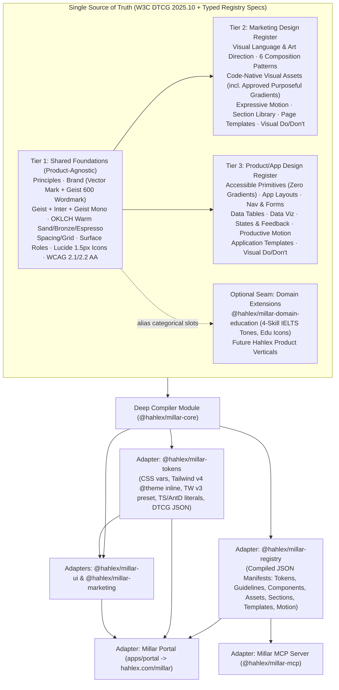

# Millar Architecture, Art Direction & Technical Specification

> **Lifecycle State**: `Accepted Baseline` (Decisions Q1-Q8 Approved 2026-11-25; New Design Tokens/Components Begin in `Draft` Until Individually Promoted to `Approved`)  
> **Repository**: `d:\projects\millar` (Standalone Monorepo; see [ADR-0003](../adr/0003-millar-hosting-and-cookie-isolation.md))  
> **Vocabulary**: Canonical domain terms follow [GLOSSARY.md](../../GLOSSARY.md). Module design follows Matt Pocock's deep-module vocabulary (`Module`, `Interface`, `Seam`, `Adapter`, `Depth`, `Leverage`, `Locality`).

---

## 1. Three-Tier Millar Architecture (+ Domain Extension Seam)

---

## 2. Tier 1: Shared Foundations (Locked Decisions Q1-Q4)

1. **Typography (Q1 Accepted)**:
   - `--font-display`: `"Geist", "Inter", ui-sans-serif, system-ui, sans-serif` (Display >= 28px: weight `300-400`; operational headings 16-22px: weight `500-600`).
   - `--font-sans`: `"Inter", ui-sans-serif, system-ui, sans-serif` (`opsz 14..32`, `+0.01em` UI chrome; optional slim `opsz 24` `wght 380/370` AI chat prose).
   - `--font-mono`: `"Geist Mono", ui-monospace, SFMono-Regular, Menlo, Consolas, monospace` (`1.85` block leading, `1.5` inline).
   - Bilingual `:root:lang(vi)` diacritic safety (`1.08 -> 1.20` display leading, `-0.02 -> -0.012em` tracking, `.line-mask` `0.16em` top clearance) + new `--text-kpi` (`1.5rem`, `700`, `tabular-nums`).
2. **Brand Identity (Q3 Accepted)**:
   - **Canonical Vector Brand Mark**: Reconstructed symmetrically from Hahlex's original Arch + 3 Pillars geometry (`viewBox="0 0 300 282"` normalized to clean geometric coordinates) in 4 official SVG variants (`color`, `on-light`, `on-dark`, `monochrome`) + PWA maskable icons (`192x192`, `512x512`).
   - **Canonical Wordmark**: Title Case **`Hahlex`** rendered in **`Geist 600`**, `-0.02em` tracking, `text-transform: none`.
3. **Unified OKLCH Color Palette & Gradient Boundary (Q2 Accepted)**:
   - One harmonized Warm Sand / Bronze / Espresso / Status / Categorical Data-Viz palette serving both registers with mathematically verified WCAG 2.1 AA contrast (`>= 4.5:1` text, `>= 3:1` UI) and Machado protan/deutan ΔE separation.
   - **Product Register**: White-First Light (`#FFFFFF` / `#FAF8F5` / `#F9F5EF`, CTA `#4A3022` `12.09:1` AAA) & Warm Obsidian Dark (`#141413` / `#1C1917`, CTA `#6B4D35` `7.67:1` AAA). **Zero CSS Gradients strictly enforced.**
   - **Marketing Register**: Editorial Cream Light (`#FFFCF8` / `#FCF8F3` / `#F6EBDE`, CTA `#4A3022` or `#7A4E16` `7.01:1` AAA) & Deep Espresso Dark (`#1A130D` / `#120C08`, text `#FFF8F0` `17.44:1` AAA, accent `#C08A4A` `6.10:1` AA). **Gradients permitted ONLY inside explicitly approved, purposeful Marketing Visual Assets** (`gradientPolicy: "approved-visual-asset"`), never as arbitrary decoration.
4. **Zero Em-Dash Boundary (Q4 Accepted)**:
   - Zero `U+2014` applies strictly to Hahlex-controlled UI, documentation, and brand copy. User-authored data, direct quotations, and third-party resources MUST NEVER be altered or corrupted.
5. **Spacing, Grid, Surface Roles, Iconography & Accessibility**:
   - `4px` micro-unit / `8px` spatial grid; unified breakpoints (`sm: 640`, `md: 768`, `lg: 1024`, `xl: 1280`, `2xl: 1440`).
   - 5 Surface Roles (`base`, `inset`, `raised`, `overlay`, `modal`), 7 radii (`xs: 4`..`pill: 9999`), canonical 17-tier z-index ladder.
   - Single semantic `lucide-react` (`1.5px` `absoluteStrokeWidth`) icon registry; universal core separated from education domain icons.
   - WCAG 2.1/2.2 Level AA baseline, APG ARIA contracts, `2px` high-contrast `.millar-focus` ring on every focusable control, `>= 24x24px` desktop / `44x44px` touch targets, `prefers-reduced-motion` static end-state guarantee.

---

## 3. Tier 2: Marketing Visual Language, Art Direction & 6 Diverse Composition Patterns (Q8 Special Focus)

To ensure AI agents and designers build compelling, memorable Hahlex marketing websites **even with zero photos, zero video, and zero animation**, Millar defines **6 distinct Composition Patterns** (never collapsing into one rigid architectural-grid template) backed by code-native Visual Assets:

| # | Composition Pattern | Rhythm & Spatial Grammar | Best Narrative Jobs | Key Visual Assets Used |
| :--- | :--- | :--- | :--- | :--- |
| **1** | **Editorial Magazine Split** (`editorial-split`) | Asymmetric 60/40 or 55/45 split with generous Warm Cream whitespace, hairline pull-quote rules, `PaperTearDivider` transitions, and calm typographic contrast (`Geist 300` + `Inter`). | Product storytelling, vision essays, founder notes, case highlights | `PaperTearDivider`, `EditorialQuoteFrame`, `MetricPlateCard` |
| **2** | **Spatial Product Stage** (`spatial-product-stage`) | Monumental centered or framed Deep Espresso (`#1A130D`) / Cream stage showcasing live stylized Hahlex UI chrome with crisp hairline elevation and interactive role/view tabs (zero empty scroll boxes!). | Hero product reveal, multi-role capability showcase, live workspace demos | `ProductWindowFrame`, `DataTableSpecimenFrame`, `AssistantThreadPreview`, `WarmHorizonWash` *(approved gradient)* |
| **3** | **Architectural Visible-Rule Grid** (`architectural-grid`) | Hairline `1px` Warm Sand coordinate matrix with subtle corner crosshairs (`+`), monospaced index numbers (`01`..`06`), and structured technical cells. | Platform architecture, security/compliance trust, developer/API specs, specs overview | `CoordinateGridSurface`, `DotMatrixField`, `LayerStackDiagram` |
| **4** | **Narrative Sequence Flow** (`narrative-sequence`) | Continuous directional flow connecting steps along a collision-free SVG loop or vertical editorial rail (automatically stacks into a legible vertical timeline on mobile). | Workflows, onboarding steps, closed-loop product pipelines, before->after transformation | `ClosedLoopSchematic`, `UnifiedOrbitDiagram`, `BeforeAfterLedger` |
| **5** | **Monumental Typographic Poster & Metric Mirror** (`typographic-poster`) | Oversized `Geist 300` display statements (`clamp(2.5rem, 6vw, 4.75rem)`) paired with high-contrast tabular-numeral `MetricMirror` strips comparing problem metrics vs. verified outcomes. | Bold value propositions, proof strips, high-impact conversion CTAs | `ConcentricArcCanvas`, `WarmHorizonWash` *(approved gradient)*, `MetricPlateCard` |
| **6** | **Asymmetric Bento Mosaic** (`bento-mosaic`) | Multi-scale irregular grid (`7:5` over `4:4:4` or `5:7` with spanning focal cell) mixing micro-diagrams, status strips, KPI plates, and mini UI chrome (explicitly replacing monotonous equal 3-column icon-card grids). | Feature overviews, capability suites, ecosystem summaries | `MetricPlateCard`, `LayerStackDiagram`, `DotMatrixField`, `AssistantThreadPreview` |

### Code-Native Visual Asset Catalog (`@hahlex/millar-marketing`)
Every asset ships with live interactive preview, source code, props API, usage guidelines, responsive behavior, `photoFree: true`, `staticFirst: true`, `gradientPolicy` (`none | approved-visual-asset`), and MCP metadata:
1. **Brand Marks**: `HahlexMark` (4 variants), `HahlexLockup` (mark + `Geist 600` wordmark).
2. **Structural & Geometric Surfaces**: `CoordinateGridSurface`, `DotMatrixField`, `ConcentricArcCanvas` (HTML5 Canvas / SVG crisp arcs), `PaperTearDivider` (procedural torn-paper SVG transition).
3. **Purposeful Approved Marketing Atmospheric Assets**: `WarmHorizonWash` (strictly controlled Warm Bronze/Espresso radial editorial horizon light, `gradientPolicy: "approved-visual-asset"`, static-first, never obscures text contrast).
4. **Technical Schematic Diagrams**: `UnifiedOrbitDiagram` (Fragmented -> Unified radial SVG), `ClosedLoopSchematic` (collision-free N-step SVG loop with mobile rail), `LayerStackDiagram` (3D-free isometric-clean architectural layer stack), `BeforeAfterLedger` (structured friction vs. clarity comparison).
5. **Stylized Product Visualizations**: `ProductWindowFrame` (clean Hahlex app chrome), `DataTableSpecimenFrame` (zero-scrollbar structured table preview), `AssistantThreadPreview` (slim `Inter opsz 24` conversation card), `MetricPlateCard` (full-box color-mixed KPI plate).

### Marketing Section Library & Page Templates
- **11 Real Sections** spanning all 6 Composition Patterns (with viewport & Light/Dark previews + copyable code + MCP metadata):
  `HeroSpatialStage`, `HeroEditorialPoster`, `ProofRibbonSection`, `BentoNarrativeMosaic`, `EditorialEssaySplit`, `ProductStageShowcase`, `WorkflowLoopSection`, `ArchitectureGridSection`, `MetricMirrorSection`, `NativeAccordionFaq`, `ClosingConversionBand` (with semantic `<footer>` strictly outside `<main>`).
- **Complete Page Templates**:
  - Marketing: `ProductLaunchTemplate`, `EditorialFeatureTemplate`, `CompanyAboutTemplate`.
  - Product: `DirectoryWorkspaceTemplate`, `RecordDetailTemplate`, `AnalyticsDashboardTemplate`, `AssistantWorkspaceTemplate`.
- **Visual Do's & Don'ts**: Side-by-side live rendered pairs contrasting generic AI anti-patterns (neon gradient cards, equal 3-column icon grids, blank scroll boxes, low-contrast bronze buttons, misused red headings) against Millar craft.

---

## 4. Deep-Module Monorepo Architecture (`d:\projects\millar`)

| Module | Interface | Seam & Adapters | Leverage & Locality |
| :--- | :--- | :--- | :--- |
| `packages/core` | `compileMillar(rootDir)`, `checkContrast(fg, bg)`, `checkColorBlindDeltaE()`, `validateLifecycle()` | Pure in-process compiler. Output seam feeds **4 real adapters**: `@hahlex/millar-tokens`, `@hahlex/millar-registry`, Portal, MCP Server. | Single edit updates CSS, Tailwind v4/v3, AntD 6 mirrors, Portal, and MCP simultaneously. |
| `packages/tokens` | `@hahlex/millar-tokens/css`, `/tailwind` (`@theme inline`), `/tailwind-v3`, `/ts` (AntD literal mirrors + cubic-bezier tuples), `/dtcg` | Generated distribution adapter at `core` seam. | Zero drift across `apps/portal`, `hahlex-edu`, and `education-portfolio`. |
| `packages/validator` | `validateDesign({ code, language, register, sourceKind }) -> { automatedChecks, humanReviewCriteria }` | Pure in-process deterministic engine shared by **2 real adapters**: CLI (`millar check`) & MCP `validate_design`. | Exact parity between AI self-validation and CI PR gates, with honest automated vs. aesthetic split. |
| `packages/ui` | Accessible Product/Shared React 19 primitives + `AntdThemeAdapter` + co-located `*.meta.ts` | Component contract seam read by `packages/core` and rendered live in Portal. | Zero stale docs; every example compiles and passes `axe-core` tests. |
| `packages/marketing` | 6 Composition Patterns, 13 Visual Assets, 11 Sections, Expressive Motion presets, Page Templates + `*.meta.ts` | Co-located spec seam read by `packages/core`, rendered live in Portal, queried via MCP. | Gives AI agents rich, photo-free marketing building blocks with copyable source. |
| `packages/domain-education` | Education semantic tokens (4-skill IELTS tones, learner mark) + education icon aliases | Domain Extension adapter plugging into Shared Foundations categorical slots. | Keeps Millar core 100% independent of education domain. |
| `packages/mcp` | MCP `2026-07-28` server (stdio + Streamable HTTP): `millar://` Resources + 11 Tools + 3 Prompts | Thin read-only adapter over compiled registry + `packages/validator`. | Tested across InMemory + stdio clients for Claude/Cursor/VS Code/Antigravity compatibility. |
| `apps/portal` | Next.js App Router + Tailwind v4 Portal (`basePath: "/millar"`, strict CSP, zero third-party scripts) | Consumer adapter proving Millar's design quality firsthand. | Ready for `hahlex.com/millar` Worker cutover once CMS origin isolation completes. |

---

## 5. Millar MCP Server Contract (`@hahlex/millar-mcp`, Q7 Accepted)

- **Resources (`millar://`)**: `millar://guidelines/invariants`, `millar://guidelines/{register}`, `millar://brand/identity`, `millar://tokens/dtcg`, `millar://tokens/resolved/{theme}/{register}`, `millar://registry/index`, `millar://composition-patterns/{id}`, `millar://components/{id}`, `millar://sections/{id}`, `millar://templates/{id}`, `millar://visual-assets/{id}`, `millar://motion-presets/{id}`, `millar://glossary`, `millar://changelog`. Missing URIs return JSON-RPC `-32602`.
- **11 Dedicated Tools** (all `readOnlyHint: true`, `idempotentHint: true`, flat cross-client JSON Schema, dual text + `structuredContent` + `resource_link`):
  1. `get_design_guidelines`
  2. `get_design_tokens`
  3. `search_components`
  4. `get_component`
  5. `search_sections`
  6. `get_section`
  7. `search_templates`
  8. `get_template`
  9. `get_visual_assets`
  10. `get_motion_presets`
  11. `validate_design` (returns `automatedChecks: { passed, summary, violations[] }` strictly separated from `humanReviewCriteria: { note, checklist[] }`!)
- **3 Prompts**: `/millar-build-marketing`, `/millar-build-product`, `/millar-audit-code`.
